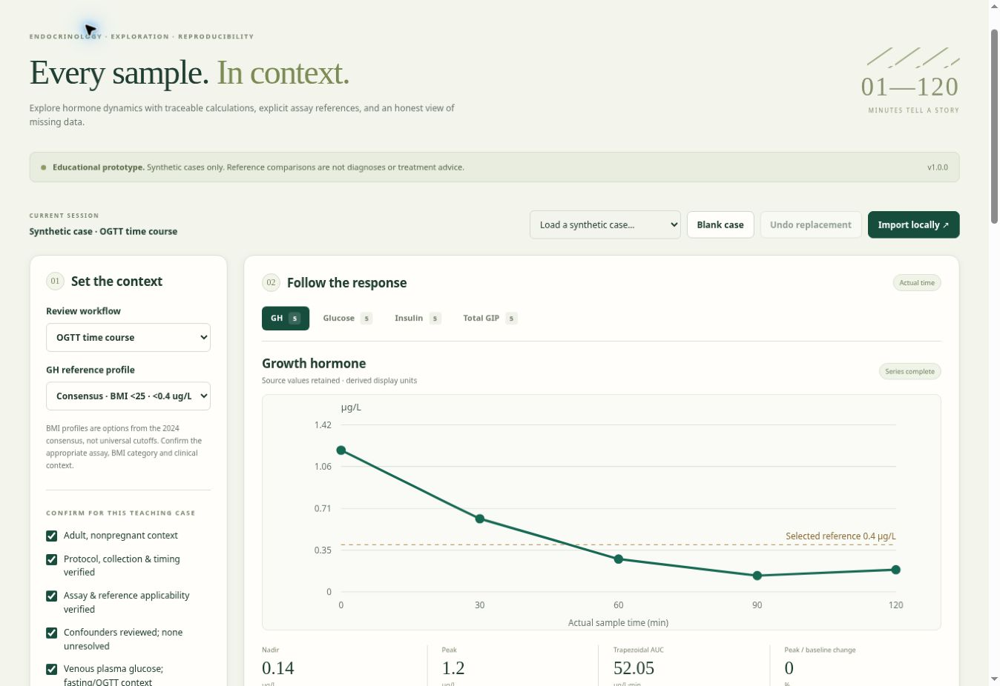

# Endocrine Dynamic-Test Studio

A browser-local endocrine time-course workspace that makes sample quality, assay assumptions and reference comparisons visible. Built as a clinical-informatics portfolio project with synthetic teaching cases and inspectable calculations.

**[Open the live studio](https://ysm19990103.github.io/endocrine-dynamic-test-studio/)** · [中文说明](docs/README.zh-CN.md) · [Clinical rules](docs/CLINICAL_RULES.md) · [Security & privacy](SECURITY.md)



> Educational prototype, not validated for patient care. Reference comparisons do not establish a diagnosis, exclude disease by themselves, or provide treatment instructions. Use synthetic teaching cases in the public demo.

## What it does

- **OGTT workspace:** inspect GH, glucose, insulin, total GIP and active GIP as separate time courses; view peak, nadir, trapezoidal AUC and baseline-relative peak change.
- **Assay-aware references:** explicitly select GH, adult standard-dose ACTH or completed overnight DST reference profiles. The 30-minute cortisol assay profiles never substitute a 60-minute result.
- **IGF-1 / ULN:** calculate the ratio using a declared appropriate laboratory reference; no guessed age range or automatic disease label.
- **Sample-quality review:** detect missing, censored, duplicate, mistimed and assay-incompatible observations. Original row order and blank rows remain intact.
- **Reproducible local files:** strict source CSV and session JSON import; source CSV, derived CSV, JSON and editable SVG downloads; print styles for reports.
- **Teaching workflow:** four wholly synthetic cases, a blank case, reversible session replacement, and English/Chinese interface labels. Source-based comparison explanations remain in English.

## Privacy by design

No API keys, account, private database, patient records, private research data, analytics or third-party runtime dependencies. Case processing occurs in browser memory. No case is saved in browser storage, cookies, URLs, a service worker or a server.

The public host still receives ordinary page/asset requests and network metadata. Downloads remain on the device. Source links open external sites. This is not a claim of regulatory compliance or a secure clinical-record system. See the [threat model](SECURITY.md).

## Run locally

Requires Node.js 22 or later. There are **zero npm dependencies** and no install step.

```sh
npm test
npm run build
npm run check
npm run dev
```

Open the local address printed by the development server (default port 5173). Do not open the source HTML via `file://`, because ES modules need a web server. To use another port: `npm run dev -- --port 4173`.

The build outputs only static app assets into `dist/`. JavaScript and CSS filenames contain content hashes to prevent stale module combinations after deployment. No environment variables, credentials or databases are required. This release does not install a service worker or promise offline availability.

## Three-minute walkthrough

1. Open the synthetic OGTT case and switch among GH, glucose, insulin and total GIP.
2. Inspect the explicit GH reference profile and context declarations. Clear a sample result to see the affected comparison held for review.
3. Load **Quality challenge**. Open **Data quality** to see the retained blank row, duplicate time points, assay change, timing mismatch and censored result.
4. Load **ACTH · Elecsys II**. Change the 30-minute result below the selected threshold; the higher 60-minute value does not override that profile.
5. Export JSON for settings plus rows, CSV for source rows, or SVG for the selected curve.

## File contract

CSV columns must appear exactly in this order:

```text
planned_min,actual_min,analyte,value,unit,qualifier,assay
```

Allowed analytes: `gh`, `glucose`, `insulin`, `gip_total`, `gip_active`, `cortisol`. Relations: `eq`, `lt`, `gt`. Units and assay declarations are controlled enums documented in [DATA_FORMAT.md](docs/DATA_FORMAT.md). Leave missing fields empty. A blank CSV record is retained; the terminal newline alone does not create an extra row.

Imports reject undocumented fields, formulas, arbitrary text, nonfinite/negative/out-of-range numbers, files over 256 KiB and more than 500 rows. Import validation is transactional: a rejected file leaves the current case unchanged. CSV imports retain the selected workflow/settings but reset clinical confirmations; JSON restores the complete validated teaching session. CSV preserves row order, empty records and numeric content, not the original byte formatting.

## Engineering and validation

The pure calculation engine is separated from file validation, visualization and browser event handling. Clinical cutoff comparisons use decimal-rational arithmetic; displayed metrics use ordinary floating-point arithmetic and formatting only after calculation. See [ARCHITECTURE.md](docs/ARCHITECTURE.md).

The initial suite has **138 passing tests** covering cutoff boundaries, unit families, censoring, missingness, row order, file round trips and hostile imports. The exercised pure modules have 100% line coverage and 92.80% branch coverage; this does **not** include browser UI, scripts or clinical validation. See [VALIDATION.md](docs/VALIDATION.md) for scope and limitations.

GitHub Actions run checks/tests/build on pushes and pull requests. The Pages workflow repeats validation before publishing `dist/`. This repository is independent of the Oncology workbenches.

## Portfolio discussion

This project demonstrates domain modeling, transparent medical-rule implementation, data provenance, strict input contracts, threat modeling, accessible interface structure and reproducible testing. It is suitable to discuss as a software engineering / clinical informatics prototype. Do not describe it as a validated medical device or as having measured clinical impact.

MIT-licensed application code. Linked medical guidance retains its original authorship and terms. No endorsement by the guideline organizations is implied.
